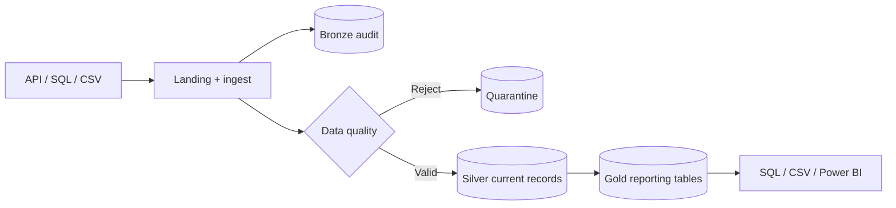

# Enterprise Retail Data Engineering Platform

**Author:** [Deepak Yermula](https://github.com/deepak-yermula) | **Portfolio:** Data Engineering | **Status:** local pipeline implemented and tested; Azure extension is a blueprint, not deployed

[](https://github.com/deepak-yermula/enterprise-retail-data-platform/actions/workflows/ci.yml)

A realistic **synthetic retail analytics capstone** showing how a Data Engineer can ingest source data, enforce quality contracts, handle incremental updates and publish reporting-ready datasets. A completely offline Python/SQLite implementation is tested; companion Azure Data Factory, ADLS Gen2, Databricks/Delta and Terraform templates show the next cloud implementation path.

> **Integrity note:** This repository does not claim Azure deployment, cloud performance benchmarks, a production customer dataset or a completed Power BI dashboard. Metrics below are reproducible from the included synthetic inputs.

## Architecture



**Local implementation:** Python standard library, SQLite, SQL analytics, `unittest`, GitHub Actions. **Cloud path:** ADF Copy + Notebook activity, ADLS Gen2, Azure Databricks Delta Lake `MERGE`, starter Terraform and dashboard design.

## Verified local result

| Metric | Result | Explanation |
|---|---:|---|
| Raw order event rows | **17** | Two synthetic batches; includes duplicates and invalid events |
| Current Silver line items | **9** | Latest valid version per line item |
| Rejected rows | **3** | Unknown customer or negative quantities/prices |
| Ingestion batches | **2** | SHA-256 batch replay guard |
| Completed sales revenue | **CAD $1,970.00** | Synthetic gross line-item revenue, not accounting recognized revenue |
| Automated local tests | **14 passing** | Assertions about quality, replay, source adapters, and reporting |

**Important behaviors:** exact duplicate input rows collapse, `updated_at` controls last-write-wins, cancelled/pending events do not contribute completed sales, and old events never overwrite newer versions. Money is stored as integer cents.

## Run in 3 commands (Python 3.10+, no pip packages)

From the extracted repository root:

```bash
python -m retail_pipeline.cli demo --db output/retail.db --out output/gold
python -m unittest discover -s tests -v
python -m retail_pipeline.cli summary --db output/retail.db
```

To simulate an **additional batch**, after the demo use:

```bash
python -m retail_pipeline.cli ingest --db output/retail.db --file path/to/orders_batch_03.csv
python -m retail_pipeline.cli export --db output/retail.db --out output/gold
```

The demo creates a local SQLite database and 3 reporting CSV files inside `output/` (excluded from Git). Running the same demo twice does not duplicate the historical input rows.

## Optional SQL and API source adapters

**SQL source (fully offline, simulated SQLite upstream database):**

```bash
python -m retail_pipeline.source_cli make-demo-sql-db --db output/source.db
python -m retail_pipeline.source_cli sql --db output/source.db --out output/from_sql.csv
python -m retail_pipeline.cli ingest --db output/retail.db --file output/from_sql.csv
```

**API source (trusted local HTTP endpoint):** start a separate terminal with `python -m http.server 8000 --directory data`, then run:

```bash
python -m retail_pipeline.source_cli api --url http://127.0.0.1:8000/api_example.json --out output/from_api.csv
python -m retail_pipeline.cli ingest --db output/retail.db --file output/from_api.csv
```

If you ingest the optional API sample, the revenue changes; the verified CAD $1,970 baseline is for the two CSV batch fixtures only. In a production API connector, implement authentication, pagination, backoff and rate limits. This small adapter demonstrates validated extraction, not a production API service.

## Repository structure

```text
enterprise-retail-data-platform/
├── retail_pipeline/          # Core pipeline, CLI, API/SQL source adapters
├── data/
│   ├── batches/              # Batch 01 and Batch 02 synthetic CSVs
│   ├── reference/            # Customer and product dimensions
│   └── api_example.json      # Local API payload fixture
├── tests/                    # Python integration and connector tests
├── sql/                      # Daily sales, top products, customer value, quality
├── examples/                 # Verified output snapshot from local run
├── docs/                     # Architecture, data contract, runbooks, Power BI
├── azure/
│   ├── adf/                  # ADF pipeline JSON template (manual wiring required)
│   ├── databricks/           # Delta Lake notebook example (not cloud-tested)
│   └── terraform/            # Azure infrastructure starter (not provisioned)
├── .github/workflows/ci.yml  # Runs standard library tests and demo on commit
├── .gitignore
└── README.md
```

## Data model and reporting

- **Bronze:** append-only raw event audit, source file fingerprint, row number.
- **Silver:** type-checked current line items and dimension tables, version-aware UPSERT.
- **Rejected:** invalid records with machine-readable failure reasons.
- **Gold:** daily revenue, product performance, customer value.
- **SQL:** `sql/01_daily_revenue.sql` through `sql/04_data_quality.sql`.
- **Power BI:** `docs/power_bi.md` documents CSV imports, measures, and avoiding different-grain double counts.

## Engineering tradeoffs

The local pipeline uses atomic SQLite transactions and full Gold refresh, appropriate for a small learning dataset. The Azure notebook example uses Spark/Delta Lake with `MERGE`, but requires ADLS and Unity Catalog access and is **not yet validated on a real Azure workspace**. Batch control writes across independent cloud tables are not globally atomic. See [architecture](docs/architecture.md), [cloud deployment guide](docs/cloud_deployment.md) and [data contract](docs/data_contract.md) for known limitations and production gaps.

## Good interview explanations

1. Why is `line_item_id` the Silver business key rather than `order_id`?
2. Why use a source fingerprint and timestamp-aware UPSERT rather than blind append?
3. How do you quarantine invalid events without losing auditability?
4. Why can a cancelled order change past reporting totals?
5. What must change when moving from SQLite to ADLS Gen2 / Spark / Delta Lake?
6. How would you make retries safe across several Delta tables and ADF activities?

## Next improvements

- Deploy Azure resources in a personal sandbox with explicit budget controls, then verify notebook and ADF integration.
- Add a production-style incremental Gold strategy, CDC source contract and source/target reconciliation.
- Create and publish a real Power BI report file with screenshots based on the Gold outputs.
- Add pipeline observability and backfill/recovery exercises using recorded test results.

All sample data in this repository is fictional and intended for portfolio learning.
