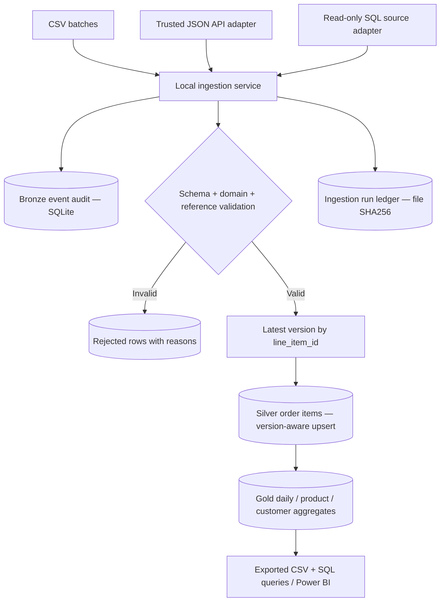
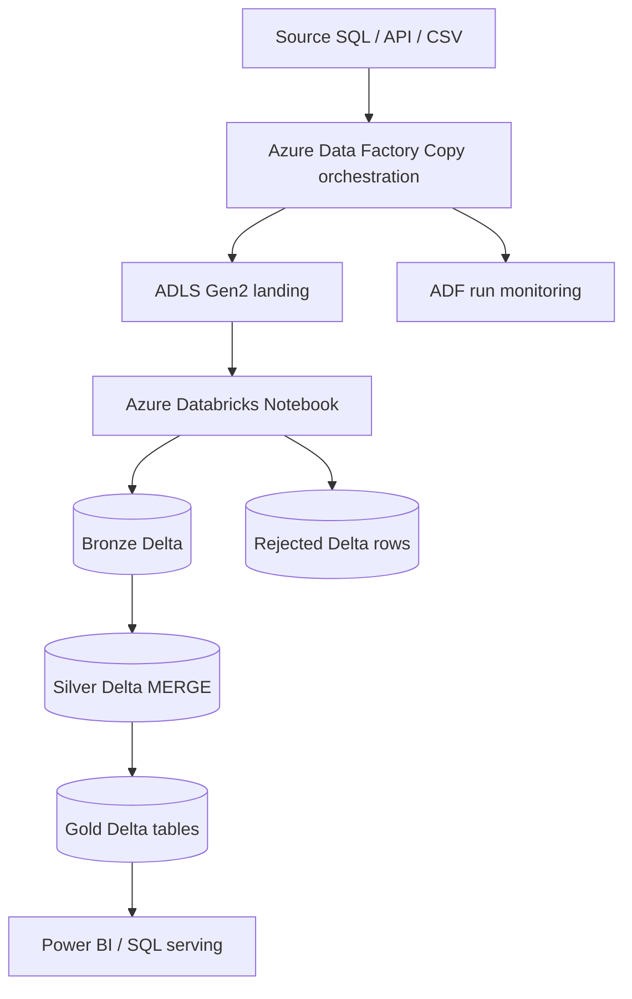

# Architecture, engineering choices, and production gaps

## A. Reproducible local system (implemented and tested)

### Key decisions

- **Business key**: `line_item_id` distinguishes order-line updates and avoids double counting.
- **Freshness**: `updated_at` UTC timestamp, not a max-watermark-only filter; older events cannot overwrite newer Silver versions.
- **Replay protection**: source SHA-256; exact same file content is skipped after successful commit.
- **Invalid records**: unknown dimension, negative quantity/price, bad status or missing field are quarantined with a reason.
- **Money**: integer cents, never float, throughout all transformations.
- **Transactions**: local SQLite commits Bronze, quarantine, Silver, Gold and run ledger in one database transaction.
- **Testing**: standard Python `unittest`, GitHub Actions smoke test, representative error cases.

### Local scaling limitation

Gold aggregates are rebuilt in full for simplicity. This is appropriate for a synthetic demo, not a recommended pattern for billion-row data. The SQLite pipeline is a **local reference implementation**, not an actual distributed Spark engine.

## B. Azure target architecture (not deployed)

- **ADF**: scheduling, dataset movement, retries and notebook dependency.
- **ADLS Gen2**: external cloud storage for lakehouse layers; secure via managed identities/Unity Catalog.
- **Delta Lake**: transactionally maintained individual Delta tables with version-aware MERGE.
- **Databricks**: Spark transforms and joins, quality checks, aggregate refresh.
- **Gold**: daily revenues, product performance, customer lifetime revenue.

## C. What would be needed before production deployment?

1. Secured networking, approved Unity Catalog storage credentials, RBAC and secret management.
2. Event contracts and schema evolution policy; metadata/audit and retention controls.
3. Batch identity and recovery consistency across independent Delta tables.
4. Observability: job duration, row count drift, freshness, incident alerts and SLA.
5. Cost/performance benchmark using realistic data volumes and partitioning choices.
6. Partition-aware incremental Gold updates, CDC correctness for updates/deletes and late arrivals.
7. Automated tests in an actual Azure workspace and deployment through staging/prod environments.

## D. Honest explanation for interviews

> I created and tested a local retail Bronze/Silver/Gold pipeline with synthetic events. It handles incremental updates, old-version replay, duplicate rows, invalid-record quarantine, and produces business reporting tables. I also designed an Azure ADF + Databricks + ADLS Gen2 implementation, including Terraform and notebook templates. The Azure portion is not yet deployed, so I can explain the design and remaining integration steps without claiming production experience.
